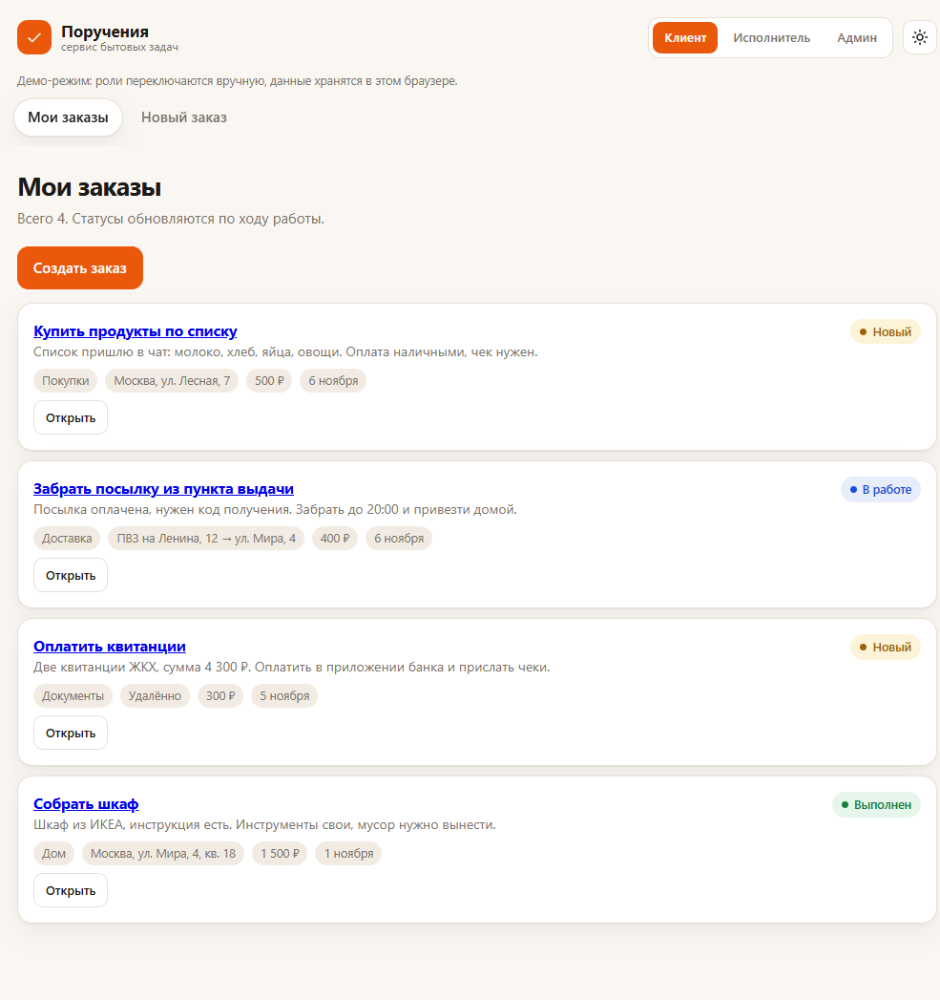
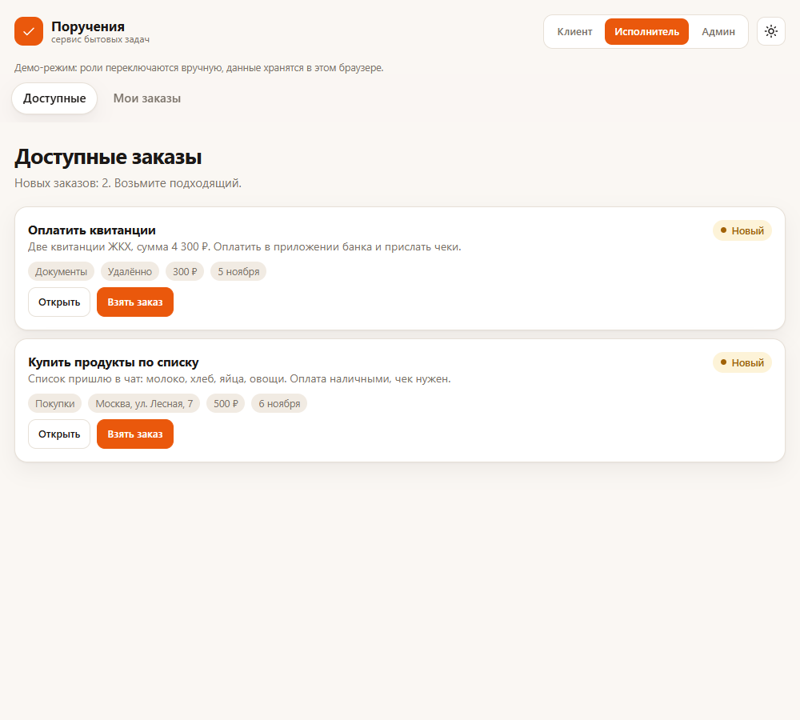
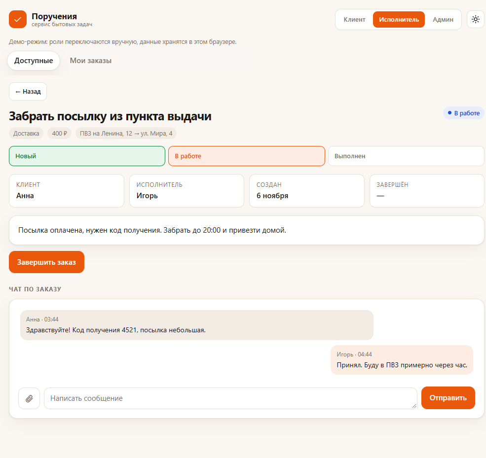
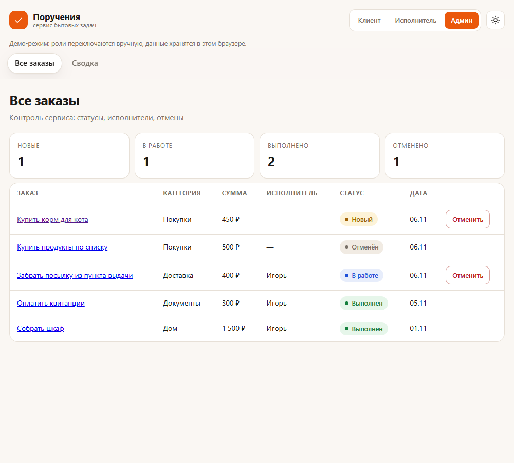
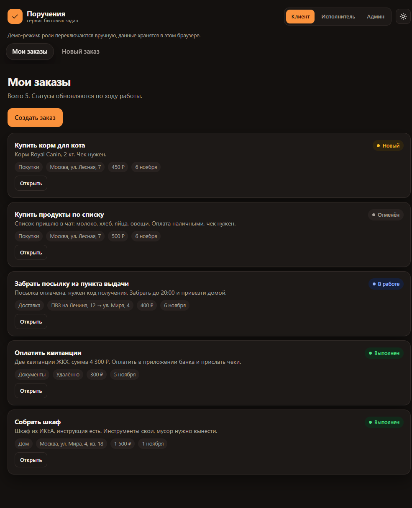
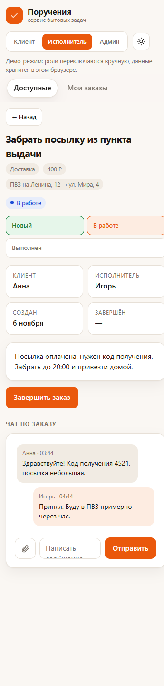

# Поручения

Веб-версия MVP по заказу Weblancer #1265080: сервис поручений, где клиент создаёт
задачу, а исполнитель берёт её и выполняет. Учебный кейс №3.

## Ссылки

- Приложение: https://fatkullinar-eng.github.io/errands/
- Код: https://github.com/fatkullinar-eng/errands

Опубликовано на GitHub Pages. Приложение статическое, сервер не нужен.

## Какая задача решается

Клиенту нужно быстро найти исполнителя на бытовую задачу — купить и принести,
забрать посылку, выгулять собаку. Обычно это переписка в мессенджере: непонятно,
кто взял заказ, на каком он этапе и сколько стоит. Приложение сводит заказ,
исполнителя, статус и переписку в одно место, а администратору даёт общую картину.

## Для кого

- **Клиент** — человек, которому нужна бытовая услуга, без установки приложения.
- **Исполнитель** — курьер или помощник, который ищет заказы рядом.
- **Администратор** — владелец сервиса: контролирует заказы и смотрит сводку.

## Стек

- HTML, CSS, JavaScript без фреймворков и сборки.
- Данные и фото — в `localStorage` браузера.
- Публикация — GitHub Pages, локальный запуск — Node.js (`server.js`).

## Что умеет

- клиент создаёт заказ: описание, категория, адрес, вознаграждение, фото;
- исполнитель видит ленту новых заказов и берёт подходящий;
- статусы: новый → в работе → выполнен; отменён;
- чат по заказу с текстом и фотографиями;
- админ видит все заказы, отменяет проблемные и смотрит сводку;
- светлая и тёмная темы;
- адаптив от 360 px.

## Роли

Роли переключаются кнопками в шапке. Это демонстрация: данные хранятся в браузере,
настоящих пользователей на разных устройствах нет.

- **Клиент** — создаёт и отменяет новые заказы.
- **Исполнитель** — берёт заказы и завершает их.
- **Админ** — контролирует все заказы и отменяет новые или взятые в работу.

## Скриншоты

| Мои заказы (клиент) | Лента заказов (исполнитель) |
| --- | --- |
|  |  |

| Страница заказа и чат | Админ-панель и сводка |
| --- | --- |
|  |  |

| Тёмная тема | Мобильная версия, 360 px |
| --- | --- |
|  |  |

## Как запустить на компьютере

Нужен Node.js. В папке проекта открой PowerShell и выполни:

```
node server.js
```

Затем открой в браузере:

```
http://localhost:3000
```

Если порт занят, задай другой:

```
$env:PORT=3002; node server.js
```

## Как опубликовать на GitHub Pages

1. Загрузить папку в репозиторий GitHub.
2. В настройках репозитория открыть Pages и выбрать ветку `main`, папку `/`.
3. Через минуту приложение будет доступно по адресу `https://<логин>.github.io/<репозиторий>/`.

Серверной части нет: приложение статическое. `server.js` нужен только локально.

## Структура

```
errands/
  index.html   — разметка
  styles.css   — оформление и темы
  app.js       — логика, роли, заказы, чат
  server.js    — мини-сервер для локального запуска
  package.json — команда запуска
  info/ТЗ.md   — техническое задание
  info/screenshots/ — скриншоты для README
```

## Ограничения MVP

- Данные хранятся в браузере: у каждого посетителя свои.
- Двое настоящих пользователей друг друга не увидят — нужен сервер.
- Регистрации и входа нет, роли переключаются вручную.
- Фото хранятся в localStorage и сжимаются; при переполнении появится предупреждение.
- Уведомлений о новых заказах и сообщениях нет.
- Оплаты, карты и рейтингов нет.

Это ограничения учебной версии, а не исходного заказа. В заказе предполагались
Flutter, Firebase и реальные пользователи — для веб-версии нужен сервер.
